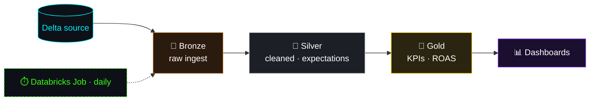
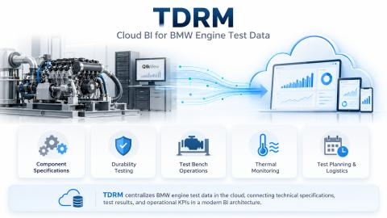
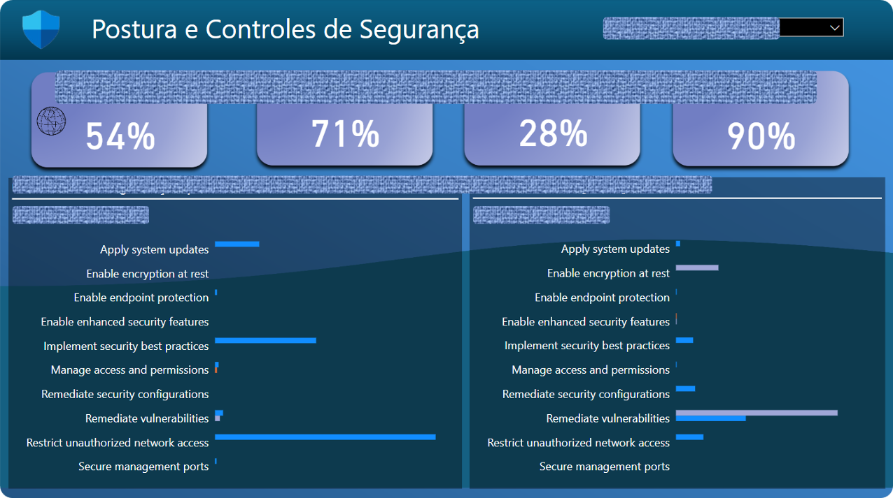
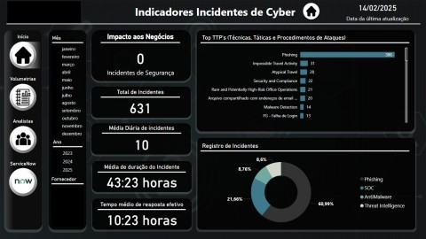
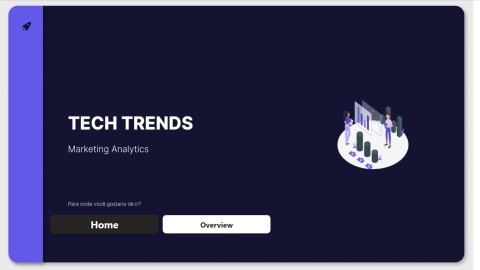

<!-- ═══════════════════════════════  HERO  ═══════════════════════════════ -->
<p align="center">
  
</p>

<p align="center">
  <a href="https://git.io/typing-svg">
    
  </a>
</p>

<p align="center">
  <a href="https://www.linkedin.com/in/matheus-felipe-p/"></a>
  
  
  
</p>

<br/>

<!-- ═══════════════════════════════  WHOAMI  ═══════════════════════════════ -->
## `> whoami`

```yaml
user:        Matheus Felipe Pereira
role:        Senior Data Analyst
experience:  6+ years
location:    São Paulo, Brazil 🇧🇷
focus:       [Business Intelligence, Product Analytics, Data Engineering, Data Visualization]
domains:     [Marketing, Product, Information Security, Corporate Analytics]
cloud:       [Azure, AWS, Databricks]
mindset:     "Extract → Transform → Model → Automate → Predict → Deliver value"
```

I help large, global organizations make **strategic decisions with data** — building KPIs, executive dashboards and automated pipelines on **AWS** and **Azure**, often in areas that had no data governance or analytical direction before.
Strong in **ETL, DataOps and data quality**, the **Power Platform**, and **Python** for statistics, A/B testing and hypothesis validation.

<br/>

<!-- ═══════════════════════════════  IMPACT  ═══════════════════════════════ -->
## `> SELECT impact FROM career;`

<table align="center">
  <tr>
    <td align="center" width="25%">
      <br/>
      <sub><b>conversion</b><br/>behavioral segmentation &amp; cohorts</sub>
    </td>
    <td align="center" width="25%">
      <br/>
      <sub><b>manual hours saved</b><br/>cloud automation &amp; pipelines</sub>
    </td>
    <td align="center" width="25%">
      <br/>
      <sub><b>high-severity risks</b><br/>security posture analytics</sub>
    </td>
    <td align="center" width="25%">
      <br/>
      <sub><b>processing time</b><br/>queries &amp; dashboard pipelines</sub>
    </td>
  </tr>
</table>

<br/>

<!-- ═══════════════════════════════  STACK  ═══════════════════════════════ -->
## `> ls ~/tech-stack`

<p align="center">
  
</p>

<table align="center">
  <tr>
    <td><b>📊 Data &amp; BI</b></td>
    <td>
      
      
      
      
      
      
    </td>
  </tr>
  <tr>
    <td><b>⚙️ Engineering &amp; Cloud</b></td>
    <td>
      
      
      
      
      
      
      
    </td>
  </tr>
  <tr>
    <td><b>⚡ Power Platform</b></td>
    <td>
      
      
      
    </td>
  </tr>
  <tr>
    <td><b>📣 Marketing &amp; Ways of working</b></td>
    <td>
      
      
      
    </td>
  </tr>
</table>

<br/>

<!-- ═══════════════════════════════  PIPELINE  ═══════════════════════════════ -->
## `> run ./data-engineering`

<table>
  <tr>
    <td>
      <h3>🧱 <a href="https://github.com/MatheusFelipePereira/Pipelines-databricks">Pipelines-databricks</a></h3>
      
      
      
      
      <p>End-to-end <b>Medallion</b> ETL (Bronze → Silver → Gold) for a marketing &amp; sales dataset with <b>Lakeflow Declarative Pipelines</b>: channel KPIs and <b>ROAS</b>, <b>data quality expectations</b>, orchestration with a <b>Databricks Job</b> and <b>incremental ingestion</b> with Streaming Tables.</p>
      <code>✅ batch pipeline</code> <code>✅ expectations</code> <code>✅ scheduled job</code> <code>🚧 incremental</code>
    </td>
  </tr>
</table>



<br/>

<!-- ═══════════════════════════════  PROJECTS  ═══════════════════════════════ -->
## `> git log --projects --featured`

<table>
  <tr>
    <td width="50%" valign="top">
      <a href="https://github.com/MatheusFelipePereira/tdrm-test-data-management"></a>
      <h3>🏎️ TDRM — Test Data &amp; Results Mgmt</h3>
      <code>2026</code> <code>act digital</code><br/>
      
      
      <p>On-prem → <b>cloud</b> migration of the dashboards used by <b>BMW's engine testing &amp; validation</b> department: specs, durability tests, test benches, thermal monitoring and test planning.</p>
      <a href="https://github.com/MatheusFelipePereira/tdrm-test-data-management">→ open repository</a>
    </td>
    <td width="50%" valign="top">
      <a href="https://github.com/MatheusFelipePereira/customer-analytics-buyers-vs-leads"></a>
      <h3>🎯 Customer Analytics — Buyers vs Leads</h3>
      <code>2025</code> <code>Data Mundo</code><br/>
      
      
      
      <p>Correlates <b>buyers and leads</b> of a digital product to find the <b>best target audience</b> for the next campaigns (ETL, DAX, M).</p>
      <a href="https://github.com/MatheusFelipePereira/customer-analytics-buyers-vs-leads">→ open repository</a>
    </td>
  </tr>
  <tr>
    <td width="50%" valign="top">
      <a href="https://github.com/MatheusFelipePereira/defender-for-cloud"></a>
      <h3>☁️ Defender for Cloud — Security Posture</h3>
      <code>Information Security</code><br/>
      
      
      <p>Cloud security posture for InfoSec leadership, fed by a daily JSON in Azure Storage. <b>−40%</b> vulnerabilities · <b>−30%</b> high-severity risks · <b>+20%</b> Secure Score.</p>
      <a href="https://github.com/MatheusFelipePereira/defender-for-cloud">→ open repository</a>
    </td>
    <td width="50%" valign="top">
      <a href="https://github.com/MatheusFelipePereira/cybersecurity-incidents-dashboard"></a>
      <h3>🔐 CyberSecurity Incidents — Dashboard</h3>
      <code>2023</code> <code>Votorantim Cimentos</code><br/>
      
      
      <p>Indicators and metrics for <b>monitoring InfoSec incidents</b> — extracted with Power Automate, modeled with DAX / Power Query.</p>
      <a href="https://github.com/MatheusFelipePereira/cybersecurity-incidents-dashboard">→ open repository</a>
    </td>
  </tr>
  <tr>
    <td width="50%" valign="top">
      <a href="https://github.com/MatheusFelipePereira/cyber-irp-incident-response"></a>
      <h3>🛡️ Cyber IRP — Incident Response App</h3>
      <code>2023–2024</code> <code>Votorantim Cimentos</code><br/>
      
      
      
      <p>End-to-end incident management on the Power Platform:<br/><code>Automate → Excel → Power Apps → Power BI</code></p>
      <a href="https://github.com/MatheusFelipePereira/cyber-irp-incident-response">→ open repository</a>
    </td>
    <td width="50%" valign="top">
      <a href="https://github.com/MatheusFelipePereira/softskills-it-management"></a>
      <h3>🧠 Soft Skills — IT Management</h3>
      <code>2025</code> <code>Votorantim Cimentos</code><br/>
      
      
      <p>Scores each team's <b>soft skills (1–5)</b> from an automated Forms survey to drive <b>targeted training</b>.</p>
      <a href="https://github.com/MatheusFelipePereira/softskills-it-management">→ open repository</a>
    </td>
  </tr>
  <tr>
    <td width="50%" valign="top">
      <a href="https://github.com/MatheusFelipePereira/techtrends-digital-marketing"></a>
      <h3>📣 TechTrends — Digital Marketing</h3>
      <code>2025</code> <code>Data Mundo</code><br/>
      
      
      <p>Click conversion, revenue, transactions and other <b>digital marketing KPIs</b> in one report.</p>
      <a href="https://github.com/MatheusFelipePereira/techtrends-digital-marketing">→ open repository</a>
    </td>
    <td width="50%" valign="middle" align="center">
      <h3>🔭 More on the way</h3>
      <p><code>while (learning) { build(); share(); }</code></p>
      <a href="https://github.com/MatheusFelipePereira?tab=repositories"></a>
    </td>
  </tr>
</table>

<br/>

<!-- ═══════════════════════════════  STATS  ═══════════════════════════════ -->
## `> cat ~/.github/stats`

<p align="center">
  
  
</p>

<p align="center">
  
</p>

<br/>

<!-- ═══════════════════════════════  CERTS  ═══════════════════════════════ -->
## `> ls ~/certifications`

<p align="center">
  
  
  
  <br/>
  
  
  
</p>

<br/>

<!-- ═══════════════════════════════  QUOTE  ═══════════════════════════════ -->
## `> echo $PHILOSOPHY`

> [!TIP]
> You'll never be *"just"* a Data Analyst. Sometimes you're a Data Engineer, sometimes a Data Scientist.
> In practice it's not only about analyzing — it's **extracting, transforming, modeling, automating, predicting** and, above all, **delivering value**.

<p align="center">
  
</p>
