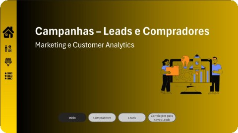
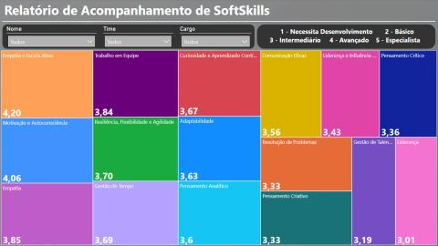
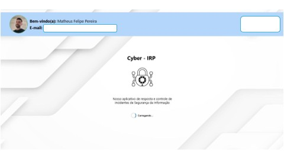

<!-- ============================  HEADER  ============================ -->
<p align="center">
  
</p>

<p align="center">
  <a href="https://git.io/typing-svg">
    
  </a>
</p>

<p align="center">
  <a href="https://www.linkedin.com/in/matheus-felipe-p/"></a>
  
  
</p>

---

## 🧭 About me

```sql
SELECT name, role, experience, focus
FROM   data_professionals
WHERE  name = 'Matheus Felipe Pereira';

-- name                    | role                | experience | focus
-- ------------------------+---------------------+------------+---------------------------------------------
-- Matheus Felipe Pereira  | Senior Data Analyst | 6+ years   | BI · Product Analytics · Data Visualization
```

Senior Data Analyst supporting strategic decision-making in large, global organizations through **Business Intelligence**, **Product Analytics** and **data visualization**.

Hands-on with **SQL, Power BI, DAX, Databricks, AWS Glue, PySpark** and data modeling, delivering solutions across **Marketing, Product, Security and Corporate Analytics** — building KPIs, executive dashboards and automated pipelines in **AWS** and **Azure**, often in areas that previously had no data governance or analytical direction.

Solid background in **ETL, DataOps, data quality** and pipeline sustainability, strong in the **Power Platform** (Power BI, Power Apps, Power Automate), and **Python** for statistical analysis, A/B testing and hypothesis validation. Agile (Scrum / Kanban) and driven by a data-driven culture focused on measurable impact.

## 📈 Impact in numbers

<table align="center">
  <tr>
    <td align="center" width="200"><h2>+15%</h2><sub>product & campaign conversion<br/>via behavioral segmentation and cohort analysis</sub></td>
    <td align="center" width="200"><h2>100+ h</h2><sub>manual hours saved per month<br/>with cloud automations & pipeline optimization</sub></td>
    <td align="center" width="200"><h2>−30%</h2><sub>high-severity security risks<br/>supporting executive decisions</sub></td>
    <td align="center" width="200"><h2>−70%</h2><sub>query & pipeline processing time<br/>for strategic dashboards</sub></td>
  </tr>
</table>

## 🛠️ Tech stack

<p>
  <b>Data & BI</b><br/>
  
  
  
  
  
  
</p>
<p>
  <b>Engineering & Cloud</b><br/>
  
  
  
  
  
  
</p>
<p>
  <b>Power Platform & Ways of working</b><br/>
  
  
  
  
  
</p>

## 🗂️ Featured projects

> Each card is a real-world analytics delivery. Click **"Details"** to expand, or open the repository for the full write-up.

<!-- ----------------------------- 1 ----------------------------- -->
### 🏎️ TDRM — Test Data & Results Management
`Mar 2026 – Oct 2026` · act digital ·  

<a href="https://github.com/MatheusFelipePereira/tdrm-test-data-management"></a>

<a href="https://github.com/MatheusFelipePereira/tdrm-test-data-management"></a>

Migration of a data-visualization application used by **BMW's engine testing & validation department** from on-premises to the **cloud**, covering several dashboard applications for the full engine test lifecycle.

<details>
<summary><b>Details</b></summary>

Scope covers the whole data-management and test-results lifecycle for engines and mechanical components:

- 🔩 Component specifications
- ⏱️ Engine durability testing & results
- 🧪 Test bench operations
- 🌡️ Thermal monitoring
- 🗓️ Test planning & logistics

**In short:** TDRM centralizes and standardizes the data generated by BMW's engine test benches in a cloud environment — from technical component specs to operational testing KPIs.
</details>

<!-- ----------------------------- 2 ----------------------------- -->
### 🎯 Customer Analytics — Buyers vs Leads
`Feb 2025 – Mar 2025` · Data Mundo ·    

<a href="https://github.com/MatheusFelipePereira/customer-analytics-buyers-vs-leads"></a>

<a href="https://github.com/MatheusFelipePereira/customer-analytics-buyers-vs-leads"></a>

Marketing report for a digital product: analyzes **buyer and lead data** to find the **best target audience** for upcoming campaigns, highlighting the direct correlation between leads and buyers and how to leverage it to attract new customers.

<details>
<summary><b>Details</b></summary>

- ETL, DAX, M (Power Query) and report design
- Customer Analytics with Meta Ads and Google Analytics data
</details>

<!-- ----------------------------- 3 ----------------------------- -->
### 🧠 Soft Skills — IT Management
`Jan 2025 – Feb 2025` · Votorantim Cimentos ·   

<a href="https://github.com/MatheusFelipePereira/softskills-it-management"></a>

<a href="https://github.com/MatheusFelipePereira/softskills-it-management"></a>

Power BI dashboard fed by an **automated Microsoft Forms** spreadsheet to visualize each team's **soft-skill levels** within its area.

<details>
<summary><b>Details</b></summary>

Each answer maps to a competency level (**1 to 5**). The report identifies the strongest and weakest behavioral skills of each person, enabling **targeted training** and specific guidance.
</details>

<!-- ----------------------------- 4 ----------------------------- -->
### 📣 TechTrends — Digital Marketing Report
`Jan 2025` · Data Mundo ·  

<a href="https://github.com/MatheusFelipePereira/techtrends-digital-marketing"></a>

<a href="https://github.com/MatheusFelipePereira/techtrends-digital-marketing"></a>

Digital marketing report showing **click conversion rates, total sales revenue, transactions and overall revenue**, among other KPIs.

<!-- ----------------------------- 5 ----------------------------- -->
### 🛡️ Cyber — IRP (Incident Response)
`Dec 2023 – Feb 2024` · Votorantim Cimentos ·   

<a href="https://github.com/MatheusFelipePereira/cyber-irp-incident-response"></a>

<a href="https://github.com/MatheusFelipePereira/cyber-irp-incident-response"></a>

Application for **Information Security incident management**, built end-to-end on the Power Platform.

<details>
<summary><b>Details</b></summary>

```text
Power Automate (PowerFX)  ──►  Excel (storage)  ──►  Power Apps (PowerFX UI)  ──►  Power BI (visualization)
     extract & transform
```
Delivered in a Scrumban flow; the Power BI output is the dashboard below.
</details>

<!-- ----------------------------- 6 ----------------------------- -->
### 🔐 CyberSecurity Incidents — Dashboard
`Aug 2023 – Nov 2023` · Votorantim Cimentos ·   

<a href="https://github.com/MatheusFelipePereira/cybersecurity-incidents-dashboard"></a>

<a href="https://github.com/MatheusFelipePereira/cybersecurity-incidents-dashboard"></a>

Indicators and metrics for **monitoring Information Security incidents**. Data extracted through **Power Automate**, transformed and loaded with **DAX / Power Query**.

<!-- ----------------------------- 7 ----------------------------- -->
### ☁️ Defender for Cloud — Security Posture
Information Security ·   

<a href="https://github.com/MatheusFelipePereira/defender-for-cloud"></a>

<a href="https://github.com/MatheusFelipePereira/defender-for-cloud"></a>

Cloud security posture dashboard for **Information Security leadership**, fed by a daily-refreshed **JSON** in an **Azure Storage Account**.

<details>
<summary><b>Details</b></summary>

- 🩹 **−40%** vulnerabilities
- 🔥 **−30%** high-severity risks
- 📈 **+20%** overall Secure Score
</details>

## 🎓 Certifications

<p>
  
  
  
  
  
  
</p>

## 💬 A thought I live by

> *You'll never be "just" a Data Analyst. Sometimes you're a Data Engineer, sometimes a Data Scientist.
> In practice it's not only about analyzing — it's extracting, transforming, modeling, automating, predicting and, above all, **delivering value**.*

<p align="center">
  
</p>
